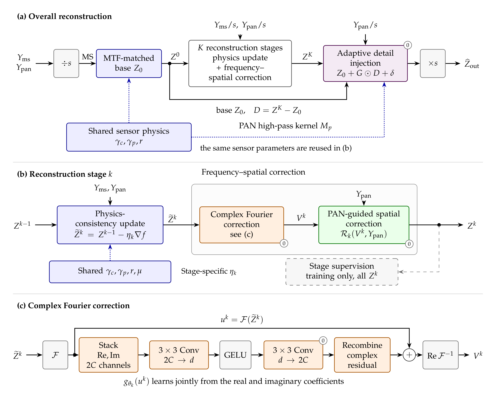

# FCU-Net

**FCU-Net: A Fourier Complex Unfolding Network with Learnable Sensor Physics for Pansharpening**

Zhikang Xiang, Yuqi Chen, Qun Wang, Le Sun, and Liang Xiao

> **Pre-publication project preview.** Code and pretrained models will be released upon publication.
> This repository currently contains the method overview, architecture figure, and reported result summaries.

## Overview

FCU-Net reconstructs high-resolution multispectral imagery from low-resolution multispectral (MS) and high-resolution panchromatic (PAN) observations. It combines three mechanisms:

1. **Physics-consistency updates.** Nominal-anchored MTF refinement and simplex-constrained spectral mixing define a learnable observation model, with MS and PAN residuals back-projected through exact adjoints.
2. **Frequency-spatial correction.** Joint real-imaginary Fourier residual learning acts on the reconstruction state, followed by PAN-guided spatial refinement.
3. **Adaptive detail injection.** An MTF-matched base shared with initialization supports band-wise and pixel-wise detail gains together with an additive correction.



## Reported results

- On WorldView-4, FCU-Net achieves **37.83 dB PSNR**, a **1.55 dB** improvement over the next-best compared method.
- On WorldView-2, it achieves **36.31 dB PSNR** and leads five of seven reduced-resolution metrics.
- With a separately trained model for each sensor, it ranks first in PSNR on five of six sensors.
- Optional calibration of the final injection module improves full-resolution observation consistency on held-out scenes, with some smoothing of fine texture.

See [Results and evaluation protocols](RESULTS.md) for numerical summaries and the distinction between reference-based reconstruction and full-resolution consistency.

## Release status

| Material | Availability |
|---|---|
| Method overview and architecture | Available in this repository |
| Reported result summaries | Available in this repository |
| Model implementation and evaluation code | Planned for release upon publication |
| Training configurations and pretrained weights | Planned for release upon publication |
| Raw satellite imagery | Obtain from the original data provider |

## Data and evaluation resources

- [NBU_PansharpRSData](https://github.com/starboot/NBU_PansharpRSData): source benchmark for the satellite imagery used in the study.
- [DLPan-Toolbox](https://github.com/liangjiandeng/DLPan-Toolbox): pansharpening comparison and evaluation resources.
- [PanCollection](https://github.com/XiaoXiao-Woo/PanCollection): pansharpening datasets and methods.

The experiments use separately trained sensor-specific models; cross-sensor results do not represent zero-shot transfer. Raw imagery and third-party baseline implementations are not redistributed here.

## Citation

The manuscript has not yet been formally published. A publication citation and DOI will be added when available.

```bibtex
@unpublished{xiang2026fcunet,
  author = {Xiang, Zhikang and Chen, Yuqi and Wang, Qun and Sun, Le and Xiao, Liang},
  title  = {{FCU-Net}: A Fourier Complex Unfolding Network with Learnable Sensor Physics for Pansharpening},
  year   = {2026},
  note   = {Manuscript}
}
```
